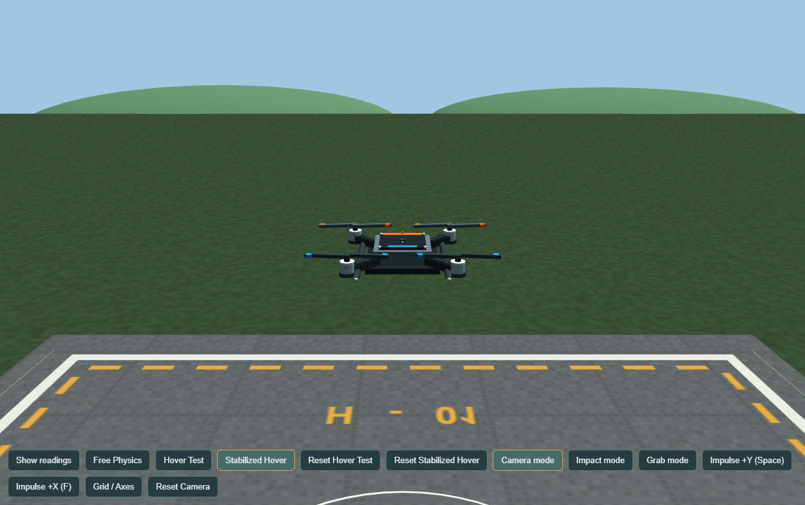
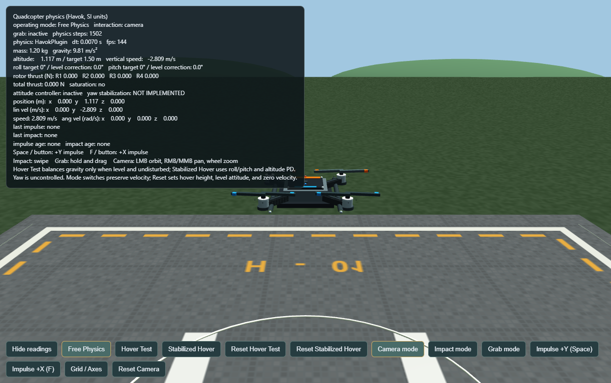
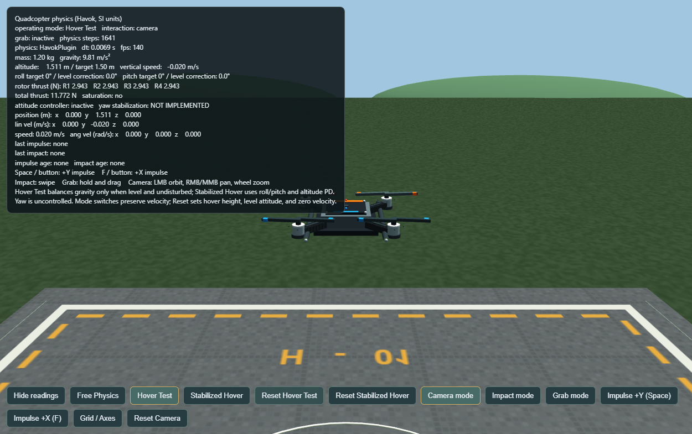
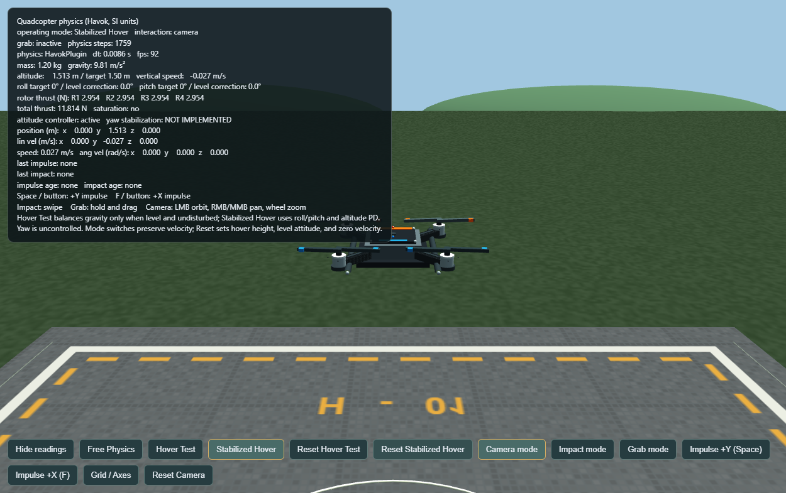
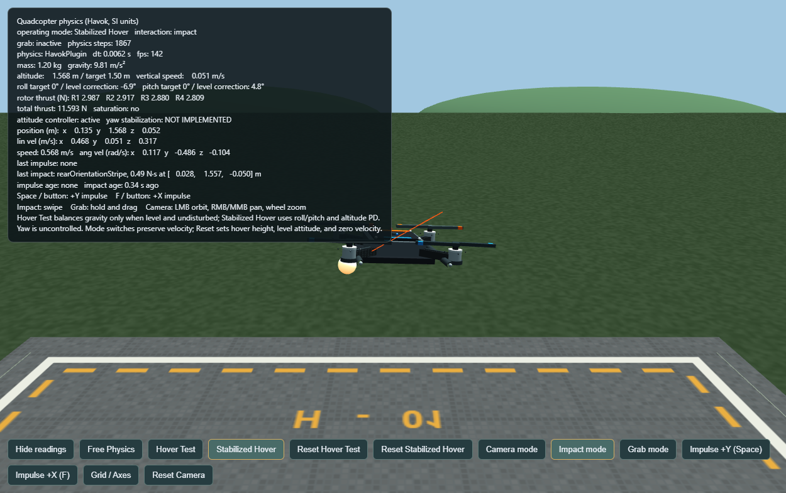

# Quadcopter Simulator

A browser-based 3D quadcopter simulator built for learning and experimentation. Explore gravity, rotor thrust, hover, stabilization, and physical interactions in a small outdoor test scene.

## Screenshots

| Simulator | Free Physics |
|---|---|
|  |  |

| Hover Test | Stabilized Hover |
|---|---|
|  |  |

| Impact disturbance |
|---|
|  |

## Features

- Three modes: **Free Physics**, **Hover Test**, and **Stabilized Hover**.
- Four physical rotor forces, plus mouse **Impact** and **Grab** interactions.
- HUD with altitude, attitude, velocity, motor thrust, and saturation readings.
- Procedural quadcopter model, outdoor landing pad, and a technical grid view.

## How it works

Babylon.js draws the scene and handles the camera. Havok Physics simulates one dynamic drone body under gravity; the four motors apply forces to that body. Hover Test shares the drone’s weight equally across four rotors (mass × gravity ÷ 4: currently 2.943 N each). Stabilized Hover adds a PD feedback controller for altitude and roll/pitch; it does not stabilize yaw or horizontal position.

## Run locally

Install [Node.js](https://nodejs.org/) and npm, then run these commands from this project folder:

```bash
npm install
npm run dev
```

Open the local URL printed by Vite (normally http://localhost:5173/). To check a production build:

```bash
npm run build
```

## Controls

- Choose **Free Physics**, **Hover Test**, or **Stabilized Hover** to change simulation mode. The two Reset buttons start their hover modes level at the target height.
- In **Camera** mode, drag with the left mouse button to orbit; right/middle drag pans; the wheel zooms.
- In **Impact** mode, swipe across the drone to apply an impulse. In **Grab** mode, hold and drag a point, then release.
- **Grid / Axes** changes the view; **Reset Camera** restores the camera. **Hide readings** toggles the telemetry.
- **Space** / **Impulse +Y** gives an upward impulse. **F** / **Impulse +X** gives a sideways impulse.

## Limitations

This is a software-only educational simulator with simplified physics and a single box-shaped drone collider. It is not real-world flight-control software and has not been validated for flying a physical aircraft. Yaw stabilization and horizontal position hold are not implemented.

## Technology

- **TypeScript** — application code.
- **Babylon.js 9.31.0** — 3D rendering, scene, and camera.
- **Havok Physics 1.3.14** — rigid-body simulation.
- **Vite 8.3.5** — local development server and production build (declared as `^8.3.4` in `package.json`).
